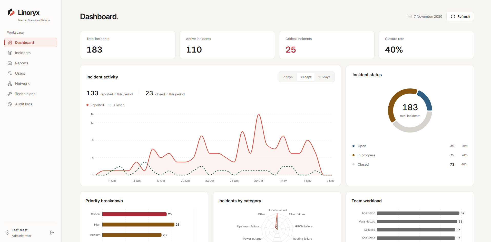
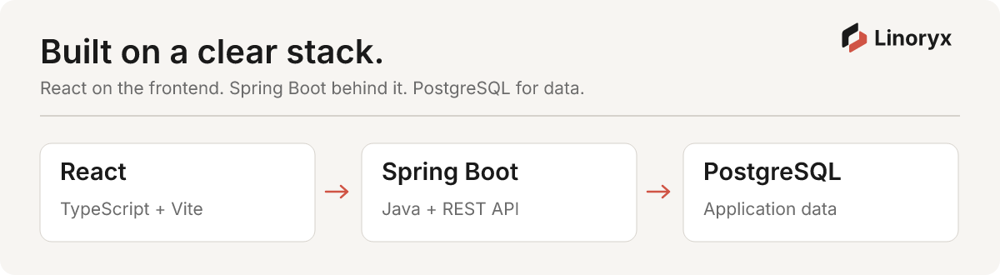
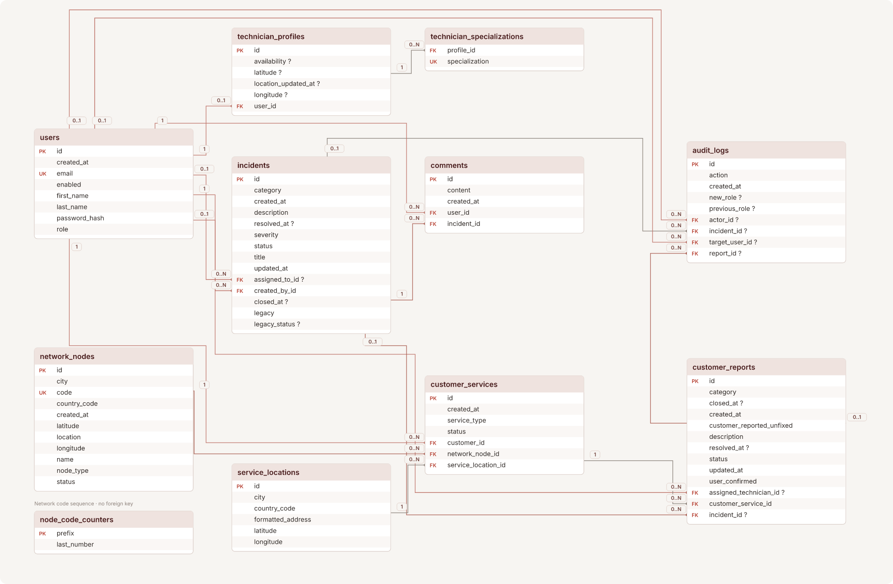
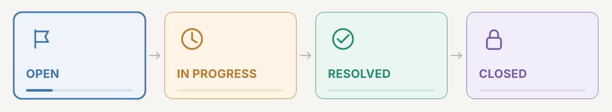

<p align="center">
  <picture>
    <source media="(max-width: 600px) and (prefers-reduced-motion: reduce)" srcset="docs/readme/visuals/header-carousel-mobile-reduced.svg" />
    <source media="(max-width: 600px)" srcset="docs/readme/visuals/header-carousel-mobile.svg" />
    <source media="(prefers-reduced-motion: reduce)" srcset="docs/readme/visuals/header-carousel-reduced.svg" />
    
  </picture>
</p>

<a id="key-capabilities"></a>

<p>
  <picture>
    <source media="(max-width: 600px)" srcset="docs/readme/visuals/key-capabilities-title-mobile.svg" />
    
  </picture>
</p>



_Operations dashboard with local demo data._

| Capability            | Implementation                                                         |
| --------------------- | ---------------------------------------------------------------------- |
| Authentication & RBAC | JWT authentication, password hashing and four user roles               |
| Services & network    | Customer services, network nodes, location maps and service history    |
| Reports & incidents   | Incident grouping, technician assignment and repair lifecycle          |
| Technician management | Availability, specializations, workload and distance-based suggestions |
| Operations dashboard  | Incident statistics, priorities, closure rates and team workload       |
| Audit & exports       | Audit logging, incident PDF/CSV exports and administrative controls    |
| Integrations          | Geoapify address verification and Spring Mail notifications            |

**Roles:** `USER` · `TECHNICIAN` · `DISPATCHER` · `ADMIN`

Geoapify handles address lookup and verification. Resolution emails can be sent through Gmail SMTP when notifications are enabled.

[Use-case diagram](docs/readme/visuals/use-cases.svg) · [Network services](docs/network-services.md) · [Email notifications](docs/email-notifications.md)

<a id="system-architecture"></a>

<p>
  <picture>
    <source media="(max-width: 600px)" srcset="docs/readme/visuals/system-architecture-title-mobile.svg" />
    
  </picture>
</p>



React communicates with a Spring Boot REST API through Nginx. PostgreSQL stores application data, while Geoapify and SMTP provide external integrations.

<a id="database-schema"></a>

<p>
  <picture>
    <source media="(max-width: 600px)" srcset="docs/readme/visuals/database-schema-title-mobile.svg" />
    
  </picture>
</p>

[](docs/readme/visuals/database-schema.svg)

11 tables · 16 foreign-key relationships

<a id="report-lifecycle"></a>

<p>
  <picture>
    <source media="(max-width: 600px)" srcset="docs/readme/visuals/report-lifecycle-title-mobile.svg" />
    
  </picture>
</p>



`OPEN → IN_PROGRESS → RESOLVED → CLOSED`

A customer submits a report, a dispatcher assigns a technician, and the technician resolves the issue. The customer confirms the repair or returns it to `IN_PROGRESS`.

An incident can close once all linked reports are closed.

<a id="testing"></a>

<p>
  <picture>
    <source media="(max-width: 600px)" srcset="docs/readme/visuals/testing-title-mobile.svg" />
    
  </picture>
</p>

| Layer        | Tools                                       | Coverage                                               |
| ------------ | ------------------------------------------- | ------------------------------------------------------ |
| Backend      | JUnit 5, Spring Boot Test, MockMvc, Mockito | Services, API access, workflows and integrations       |
| Database     | Spring integration tests, PostgreSQL        | Persistence and concurrent operations                  |
| Frontend     | Vitest, Testing Library                     | Components, authentication, API handling and workflows |
| Code quality | Oxlint, TypeScript, Vite                    | Linting, type checks and production build              |

Backend verification uses a separate PostgreSQL test database.

```powershell
docker compose up -d db
docker compose exec db psql -U vigil_api_user -d vigil_db -c "CREATE DATABASE linoryx_test;"

Push-Location linoryx-api
$env:DB_URL = 'jdbc:postgresql://localhost:5433/linoryx_test'
.\mvnw.cmd clean verify
Remove-Item Env:DB_URL
Pop-Location
```

Frontend verification:

```powershell
Push-Location linoryx-web
npm.cmd test
npm.cmd run lint
npm.cmd run build
Pop-Location
```

[Backend test source](linoryx-api/src/test/java/com/linoryx/api) · [Frontend test source](linoryx-web/tests) · [Previous validation results](docs/rebrand-validation.md)

<a id="ci-cd-azure"></a>

<p>
  <picture>
    <source media="(max-width: 600px)" srcset="docs/readme/visuals/ci-cd-azure-title-mobile.svg" />
    
  </picture>
</p>

**Planned — not deployed yet.**

The planned GitHub Actions pipeline will automate backend and frontend tests, code checks, Docker image builds and deployment to Azure.

The target is a publicly accessible demo with the frontend, REST API and database hosted in Azure.

<a id="tech-stack"></a>

<p>
  <picture>
    <source media="(max-width: 600px)" srcset="docs/readme/visuals/tech-stack-title-mobile.svg" />
    
  </picture>
</p>

| Layer                | Technologies                                       |
| -------------------- | -------------------------------------------------- |
| Frontend             | React 19, TypeScript 6, Vite 8                     |
| UI & visualization   | Lucide, Recharts, Leaflet, React PDF               |
| Backend              | Java 25, Spring Boot 4.1, Spring Security          |
| API & authentication | REST, JWT, OpenAPI                                 |
| Persistence          | PostgreSQL 18, Spring Data JPA, Hibernate          |
| Integrations         | Geoapify, Spring Mail, Gmail SMTP                  |
| Testing              | JUnit 5, MockMvc, Mockito, Vitest, Testing Library |
| Infrastructure       | Docker Compose, Nginx                              |
| Planned deployment   | GitHub Actions, Azure                              |

<a id="run-locally"></a>

<p>
  <picture>
    <source media="(max-width: 600px)" srcset="docs/readme/visuals/run-locally-title-mobile.svg" />
    
  </picture>
</p>

**Requirements:** JDK 25, Node.js 22.12+, Docker Desktop with Linux containers.

The commands below use PowerShell from the repository root.

### Environment

Copy the example configuration files:

```powershell
if (!(Test-Path .env)) { Copy-Item .env.example .env }
if (!(Test-Path linoryx-api/.env)) { Copy-Item linoryx-api/.env.example linoryx-api/.env }
if (!(Test-Path linoryx-web/.env)) { Copy-Item linoryx-web/.env.example linoryx-web/.env }
```

Configure:

- `DB_PASSWORD` — same value in root and API configuration.
- `JWT_SECRET` — random secret of at least 32 ASCII characters.
- `VITE_API_BASE_URL=/api`
- `GEOAPIFY_API_KEY` — optional, for address search.

Email notifications are disabled by default. See [email setup](docs/email-notifications.md).

Keep credentials in local, ignored `.env` files.

### Build & start

```powershell
Push-Location linoryx-api
.\mvnw.cmd clean package -DskipTests
Pop-Location

Push-Location linoryx-web
npm.cmd ci
npm.cmd run build
Pop-Location

docker build -t linoryx-api:local ./linoryx-api
docker build -t linoryx-web:local ./linoryx-web
docker compose up -d
```

| Service     | URL                                         |
| ----------- | ------------------------------------------- |
| Application | http://localhost:8081                       |
| Swagger UI  | http://localhost:8080/swagger-ui/index.html |
| PostgreSQL  | localhost:5433                              |

### First administrator

Register an account, then assign the administrator role:

```powershell
docker compose exec db psql -U vigil_api_user -d vigil_db -c "UPDATE users SET role = 'ADMIN' WHERE email = 'your@example.com';"
```

Sign in again to refresh the role.

The local database retains the `vigil_api_user` and `vigil_db` identifiers for compatibility with existing data.

### Development mode

Run in separate terminals:

```powershell
docker compose up -d db
```

```powershell
cd linoryx-api
.\mvnw.cmd spring-boot:run
```

```powershell
cd linoryx-web
npm.cmd run dev
```

The Vite development server proxies `/api` requests to the backend.

---

**Documentation:** [Demo data](docs/demo-data.md) · [Frontend design](docs/frontend-design.md) · [Technician management](docs/technician-management.md) · [Report categories](docs/incident-categories.md) · [Brand guidelines](docs/brand-guidelines.md)
