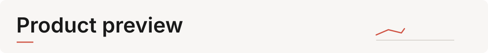
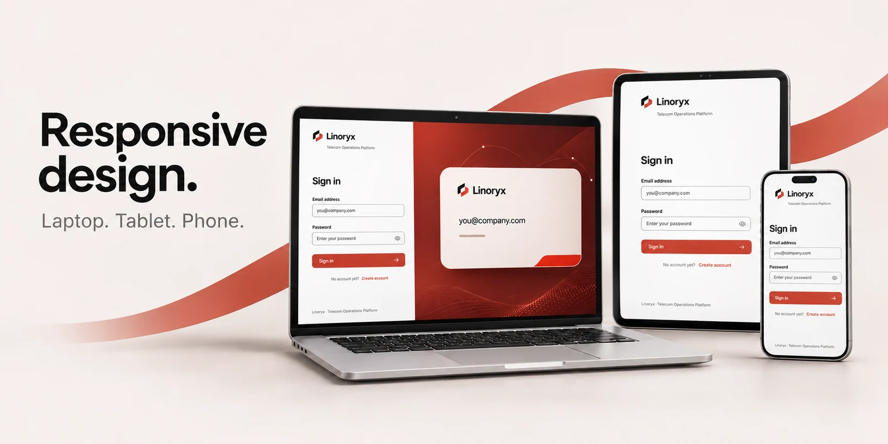
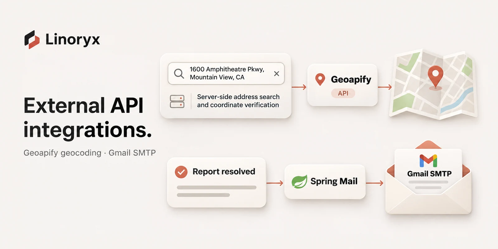
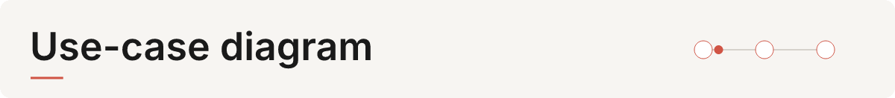
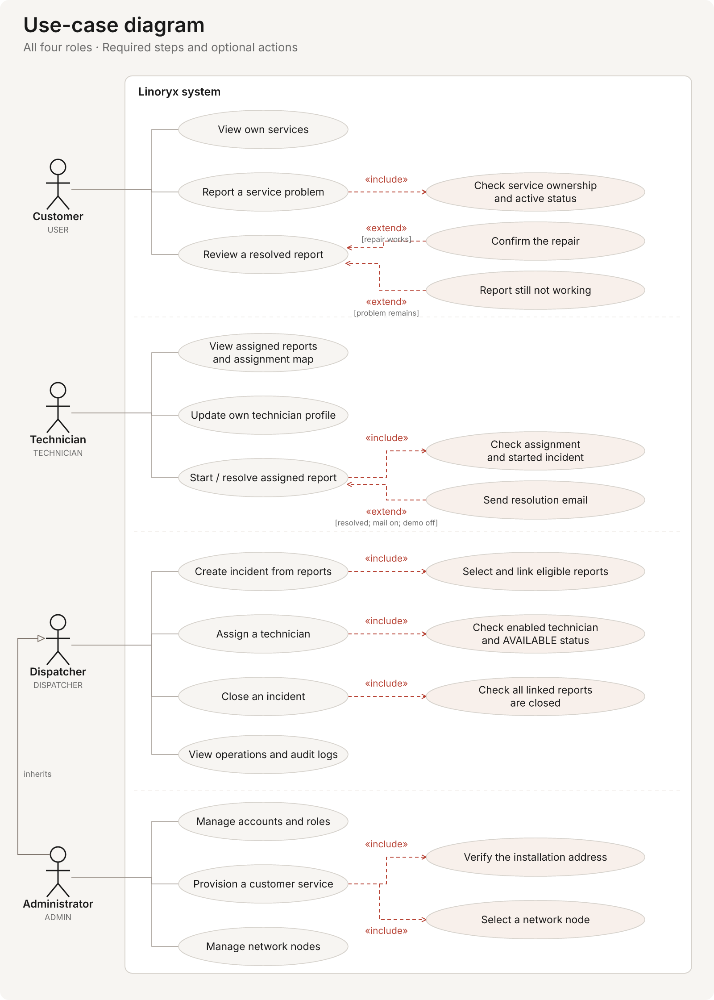
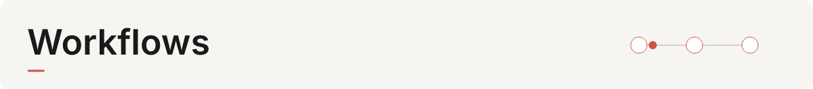
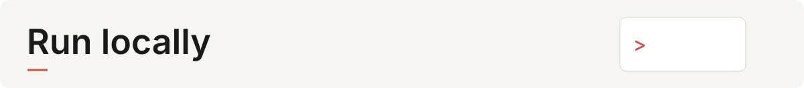
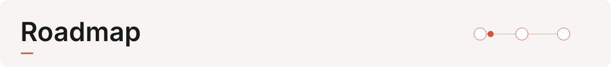

<p align="center">
  <picture>
    <source media="(prefers-reduced-motion: reduce)" srcset="docs/readme/visuals/overview.webp" />
    
  </picture>
</p>

<p align="center">
  <a href="docs/readme/visuals/overview.webp">Overview</a> ·
  <a href="docs/readme/visuals/integrations.webp">Integrations</a> ·
  <a href="docs/readme/visuals/responsive.webp">Devices</a>
</p>

# Linoryx — Telecom Operations Platform

Linoryx is a full-stack project for managing telecom services and repair reports. It is built with React, Spring Boot and PostgreSQL.

The project covers role-based access, report workflows, database relationships, external integrations and testing. You can run it locally with Docker.

## <picture><source media="(prefers-reduced-motion: reduce)" srcset="docs/readme/visuals/product-preview-title.png" /></picture>

The dashboard shows open incidents, priorities and team workload. Here is the app running with local demo data.


- **Live demo:** coming soon.
- **Screenshots:** [dashboard](docs/readme/dashboard.jpg), [sign-in](docs/readme/captures/login-desktop.jpg) and [incident details](docs/readme/incident.jpg).
- **Product walkthrough video:** coming soon.

## <picture><source media="(prefers-reduced-motion: reduce)" srcset="docs/readme/visuals/responsive-design-title.png" /></picture>



The layout adapts to laptops, tablets and phones. The sign-in form stays simple on smaller screens, with the artwork shown on desktop.

## <picture><source media="(prefers-reduced-motion: reduce)" srcset="docs/readme/visuals/external-integrations-title.png" /></picture>



- **Geoapify:** the backend searches addresses and verifies the selected location before saving it. The API key stays on the server.
- **Gmail SMTP:** Spring Mail sends a notification after a technician resolves a report. The customer follows the link to review the repair. Email is disabled by default.

See [location setup](docs/network-services.md) and [email notifications](docs/email-notifications.md) for details.

## <picture><source media="(prefers-reduced-motion: reduce)" srcset="docs/readme/visuals/existing-features-title.png" /></picture>

| Area | What it does |
| --- | --- |
| Authentication | Register and sign in with password hashing, JWT sessions and access based on user roles. |
| Customer services | Add services with an address and network node, track their status, and keep service history. |
| Network | Manage network nodes, search and filter them, and view their locations on a map. |
| Customer reports | Report service problems, link reports to incidents, assign technicians and track repairs. |
| Incidents | Group reports, set categories and priorities, add comments and track progress. |
| Technicians | Manage availability, locations and specializations. Suggest technicians based on workload and distance. |
| Dashboard | View incident activity, status, priority, categories, closure rate and team workload. |
| Administration and audit | Manage accounts and roles, and review account and workflow changes. |
| Exports and alerts | Export incidents as PDF or CSV. Email customers when their report is resolved, if email is enabled. |

Address search needs a Geoapify API key. Maps use Leaflet and OpenStreetMap and need an internet connection. Existing records remain available without the key.

## <picture><source media="(prefers-reduced-motion: reduce)" srcset="docs/readme/visuals/roles-title.png" /></picture>

| Role | Access |
| --- | --- |
| Customer (`USER`) | View their services, report problems and confirm repairs. |
| Technician (`TECHNICIAN`) | Work on assigned reports and view related incidents, their dashboard, profile and assignment map. |
| Dispatcher (`DISPATCHER`) | Manage reports and incidents, assign technicians, and view the dashboard and audit logs. |
| Administrator (`ADMIN`) | Dispatcher access plus account, customer-service and network management. |

New accounts start as customers. The backend checks permissions for each role.

## <picture><source media="(prefers-reduced-motion: reduce)" srcset="docs/readme/visuals/use-case-diagram-title.png" /></picture>

The diagram shows the main actions for all four roles. `«include»` means a required step; `«extend»` means an optional action. Administrators also have dispatcher access.

[](docs/readme/visuals/use-cases.svg)

[Editable use-case source](docs/readme/visuals/source/use-cases.puml)

## <picture><source media="(prefers-reduced-motion: reduce)" srcset="docs/readme/visuals/workflows-title.png" /></picture>

<picture>
  <source media="(prefers-reduced-motion: reduce)" srcset="docs/readme/visuals/workflow.png" />
  
</picture>

1. A customer reports a problem with an active service.
2. An administrator or dispatcher links the report to an incident, starts the incident and assigns a technician.
3. The technician starts the work and marks the report as resolved.
4. The customer confirms the repair, and an administrator or dispatcher closes the report. If the problem remains, the report goes back to work in progress.
5. The incident can close once all linked reports are closed.

Reports use `OPEN → IN_PROGRESS → RESOLVED → CLOSED`. Incidents use `OPEN → IN_PROGRESS → CLOSED`.

## <picture><source media="(prefers-reduced-motion: reduce)" srcset="docs/readme/visuals/architecture-and-stack-title.png" /></picture>

```text
Browser → Nginx / React → Spring Boot REST API → PostgreSQL
                               ├─ SMTP email
                               └─ Geoapify location lookup
```

| Layer | Technologies |
| --- | --- |
| Frontend | React 19, TypeScript 6, Vite 8, Lucide, Recharts, Leaflet and React PDF. |
| Backend | Java 25, Spring Boot 4.1, Spring Security, JWT, Spring Data JPA, Spring Mail and OpenAPI. |
| Database | PostgreSQL 18, Hibernate and `schema.sql` for database setup. |
| Testing | JUnit, Spring tests, Vitest, Testing Library, Oxlint and TypeScript. |
| Local hosting | Docker Compose and Nginx. |

The backend uses controllers for requests, services for application logic and repositories for database access.

```text
linoryx-api/
  src/main/java/com/linoryx/api/   Backend code
  src/main/resources/            Configuration and database setup
  src/test/java/com/linoryx/api/  Backend tests
linoryx-web/
  src/pages/                     Application screens
  src/components/                Shared components
  src/api/                       Typed API clients
  src/services/                  Sessions and exports
  src/tokens.css                 Shared styles and colors
  public/brand/                  Linoryx logo, icons and artwork
  public/fonts/                  Inter fonts
scripts/                         Local demo-data utility
docs/                            Project documentation
compose.yaml                     Local Docker services
```

## <picture><source media="(prefers-reduced-motion: reduce)" srcset="docs/readme/visuals/database-schema-title.png" /></picture>

The database has 11 tables and 16 foreign-key relationships. The overview shows the main fields, keys and relationships. Click it to open the full schema with all columns.

[](docs/readme/visuals/database-schema.svg)

[Editable schema source](docs/readme/visuals/source/database-schema.dot)

## <picture><source media="(prefers-reduced-motion: reduce)" srcset="docs/readme/visuals/run-locally-title.png" /></picture>

Install JDK 25, Node.js 22.12+ and Docker Desktop with Linux containers. The Maven Wrapper is included. Run these commands in PowerShell from the project root.

Copy the example environment files if you do not already have them:

```powershell
if (!(Test-Path .env)) { Copy-Item .env.example .env }
if (!(Test-Path linoryx-api/.env)) { Copy-Item linoryx-api/.env.example linoryx-api/.env }
if (!(Test-Path linoryx-web/.env)) { Copy-Item linoryx-web/.env.example linoryx-web/.env }
```

Update the local `.env` files:

- Set the same `DB_PASSWORD` in the root and API files.
- Set a random `JWT_SECRET` of at least 32 ASCII characters in `linoryx-api/.env`.
- Keep `VITE_API_BASE_URL=/api` in `linoryx-web/.env`.
- For address search, set `GEOAPIFY_API_KEY` in the root and API files.
- Email is off by default. See [email setup](docs/email-notifications.md) to enable it. Keep it disabled for public demos.

Keep passwords and API keys in the ignored local `.env` files.

Build the applications and images:

```powershell
Push-Location linoryx-api
.\mvnw.cmd clean package -DskipTests
Pop-Location

Push-Location linoryx-web
npm.cmd ci
npm.cmd run build
Pop-Location

docker build -t linoryx-api:local ./linoryx-api
docker build -t linoryx-web:local ./linoryx-web
docker compose up -d
```

Open [the app](http://localhost:8081) or [Swagger UI](http://localhost:8080/swagger-ui/index.html). The database runs on local port 5433. Nginx forwards `/api` requests to the backend.

To create the first administrator on a fresh database, register an account in the app, then run this with your email:

```powershell
docker compose exec db psql -U vigil_api_user -d vigil_db -c "UPDATE users SET role = 'ADMIN' WHERE email = 'your@example.com';"
```

Sign in again to use the administrator role. You can manage other accounts from the Users screen. See [demo data](docs/demo-data.md) for sample accounts and records.

For development, run these in separate terminals:

- From the project root: `docker compose up -d db`.
- From `linoryx-api`: `.\mvnw.cmd spring-boot:run`.
- From `linoryx-web`: `npm.cmd run dev`.

Vite forwards `/api` requests to `API_PROXY_TARGET`, which defaults to `http://localhost:8080` in the example file.

## <picture><source media="(prefers-reduced-motion: reduce)" srcset="docs/readme/visuals/testing-title.png" /></picture>

Use a separate database for backend tests:

```powershell
docker compose up -d db
# Create once; use a distinct name for an existing test database if needed.
docker compose exec db psql -U vigil_api_user -d vigil_db -c "CREATE DATABASE linoryx_test;"

Push-Location linoryx-api
$env:DB_URL = 'jdbc:postgresql://localhost:5433/linoryx_test'
.\mvnw.cmd clean verify
Remove-Item Env:DB_URL
Pop-Location

Push-Location linoryx-web
npm.cmd test
npm.cmd run lint
npm.cmd run build
Pop-Location
```

The tests cover sign-in, permissions, services, reports, incidents and technicians. The frontend build also checks TypeScript. Previous local results are in [rebranding validation](docs/rebrand-validation.md).

## <picture><source media="(prefers-reduced-motion: reduce)" srcset="docs/readme/visuals/upgrading-title.png" /></picture>

The folders are now `linoryx-api` and `linoryx-web`, and the Java package is `com.linoryx.api`. Update any IDE settings or scripts that use the old paths. Keep your existing `.env` values.

Rebuild the Docker images using the commands above, then run `docker compose up -d`. The database names and Docker volume stay the same so existing data is kept. Use `docker compose down` without `-v` to stop the stack and keep the database.

Some internal names still use `vigil` to keep existing data and sessions working. See [brand guidelines](docs/brand-guidelines.md) for details.

## <picture><source media="(prefers-reduced-motion: reduce)" srcset="docs/readme/visuals/documentation-title.png" /></picture>

- [Brand guidelines](docs/brand-guidelines.md)
- [Frontend design](docs/frontend-design.md)
- [Network nodes and customer services](docs/network-services.md)
- [Report and incident categories](docs/incident-categories.md)
- [Technician management](docs/technician-management.md)
- [Local demo data](docs/demo-data.md)

## <picture><source media="(prefers-reduced-motion: reduce)" srcset="docs/readme/visuals/roadmap-title.png" /></picture>

- Hosted demo and cloud deployment.
- More product screenshots and a walkthrough video.
- CI/CD pipeline.
